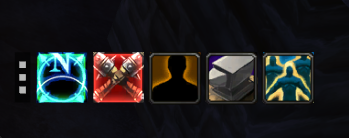
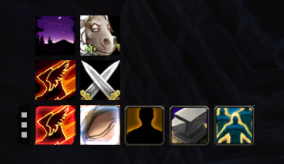
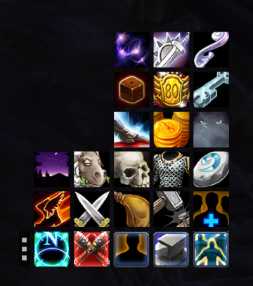
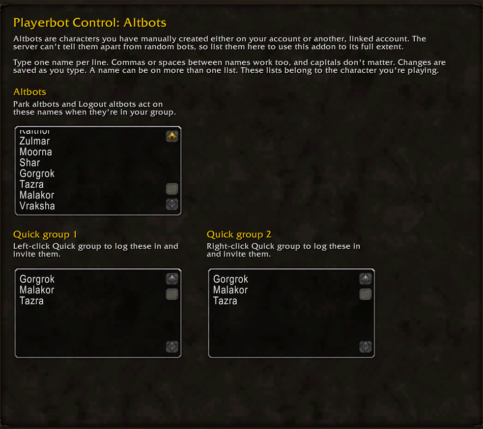

# Playerbot Control 1.0.2

**A World of Warcraft 3.3.5a addon with a small, clean control bar for your
[playerbots](https://github.com/mod-playerbots/mod-playerbots), for realms running
[mod-multibot-bridge](https://github.com/Wishmaster117/mod-multibot-bridge).**

It keeps the handful of orders you give every day one click away, and always shows what your bots were
last told. Orders go to the server through mod-multibot-bridge, so nothing is typed into chat and no bot
is whispered.

- **Follow or Stay** and **Passive or Active** are single buttons that show the current mode, with a
  coloured glow so you can tell at a glance.
- **Attack** and **CC** work on whatever you have targeted, in a party or a raid.
- **Group** and **Upkeep** hold the less frequent orders: drink, release, revive, roll, reset, maintenance,
  autogear, sell, level sync and raid tokens.
- **Party** looks after your altbots: bring a few in with one click, park them at an inn, or log them out,
  without touching random bots or other players.
- The bar can be moved anywhere, resized, hidden from a minimap button, and every button can be switched
  off.

Open the options with `/pbc`, or right-click the minimap button or the grip on the left of the bar.

## Screenshots

<table>
<tr>
<td align="center" valign="bottom"> The bar, groups closed. Follow / Stay and Passive / Active sit on the bar itself.</td>
<td align="center" valign="bottom"> Movement and Combat opened with a right-click, bots fleeing (red).</td>
<td align="center" valign="bottom"> Every group open.</td>
</tr>
</table>

 The Altbots page, with your altbots and two Quick group lists.

## What's on the bar

The bar has one button per group.

- **Movement** and **Combat** show their toggle on the bar. **Left-click** uses it, **Shift-click** repeats
  its current order for bots that just joined, and **right-click** shows or hides the group's other
  buttons above it.
- **Group**, **Upkeep** and **Party** have a plain group button. Click it to show or hide the group's
  buttons.

Groups you leave open stay open. Anything that can't be undone asks first.

### Movement

| Button | What it does |
| --- | --- |
| **Follow / Stay** (on the bar) | Tells the bots in your group to follow you or to stay where they are. Green glow: following. Orange: staying. Red: fleeing. |
| **Flee** | Your bots run to you and ignore enemies until you order Follow or Stay. |
| **Summon** | Brings the bots in your group to you. |

### Combat

| Button | What it does |
| --- | --- |
| **Passive / Active** (on the bar) | Passive bots don't fight. Blue glow: passive. Red: active. |
| **Attack my target** | Your bots attack what you have targeted. It also puts the Skull marker on it, which you can switch off in the options. |
| **CC my target** | Puts the Moon marker on your target; bots that can crowd control keep it controlled. Right-click takes the marker off. |

### Group

| Button | What it does |
| --- | --- |
| **Drink** | Bots that are short of mana sit down to drink. Not while mounted or in combat. |
| **Release** | Dead bots release their spirit to the nearest graveyard. |
| **Revive** | Bots that released come back to life at the graveyard's spirit healer. |
| **Roll** | Every bot in your group rolls 1-100. |
| **Reset** | For bots that are stuck. Left-click: they drop what they're doing and start over. Shift-click: resets their AI to its default strategies, after asking. |

### Upkeep

| Button | What it does |
| --- | --- |
| **Maintenance** | Playerbots' maintenance for every bot in your group: repairs, reagents, food, ammo, spells and the like. The server allows four bots per ten seconds, so the number on the button counts down. |
| **Autogear** | Gives every bot in your group new gear for its level from the server's item pool, within the server's limits. Replaces what they wear, so it asks first. |
| **Sell** | Each bot sells to a vendor it is standing next to. Left-click: grey items only. Shift-click: everything the bots count as vendor trash, after they equip upgrades from their bags; asks first. |
| **Level sync** | Runs mod-levelsync's level sync (`.levelsync level on`). Only shown when the server has the module. |
| **Raid tokens** | mod-token-turnin. Left-click: check what would be redeemed, changing nothing. Shift-click: redeem, after asking. Only shown when the server has the module. |

### Party

Altbots are characters you have manually created, on your own account or another, linked account. The
server can't tell them apart from random bots, so you list their names in the options (see
[Altbots](#altbots)).

| Button | What it does |
| --- | --- |
| **Quick group** | Left-click: Quick group 1. Right-click: Quick group 2. Brings in the bots on that list: logs in the ones that are offline (they join you by themselves) and invites the ones that are online, such as parked ones. Turns your party into a raid when a sixth member needs it. If a bot is stuck in another group without you, a game master's Quick group frees it (`.group remove`) and invites it again; otherwise it tells you which bot is stuck. |
| **Park altbots** | Your listed altbots in the group stay where they are and leave the group, but stay online, for example at an inn. Random bots and players carry on as before. |
| **Logout altbots** | Your listed altbots in the group leave it and log out. Asks first. Parked altbots, random bots and players aren't affected. |
| **Reset dungeons** | The game's own reset of your normal dungeons. You need to be the group leader. |
| **Reset raid lockouts** | Removes raid and dungeon lockouts, except for the instance each character is in. Left-click: you and every bot in your group. Right-click: you and everyone in your group, players too. Uses `.instance unbind all` if you're a game master, otherwise `.levelsync unbindall`. Asks first, naming everyone it will reset, and prints one line with the total. |

Park, Logout and inviting need you to be the group leader.

A **?** on Follow / Stay or Passive / Active means no order has been given yet this session, so the addon
doesn't know the mode. Leaving your group clears both.

Playerbots switches passive off whenever bots are told to follow or stay. While the Passive button is on,
the addon puts it straight back, so the button stays right.

## Options

Under **Interface > AddOns > Playerbot Control**, or `/pbc`:

- **Size**: scale the bar from 50% to 200%.
- **Show the bar**: the minimap button and `/pbc toggle` switch this too.
- **Lock the bar in place**: hides the grip on the left of the bar. Unlocked, drag the grip to move it.
- **Open groups downwards**: a group's buttons appear below the bar instead of above it.
- **Show the minimap button**: left-click it to show or hide the bar, right-click it for the options, drag
  it to move it around the minimap.
- **Reset position**: puts the bar back in the middle of the screen.
- **Attack also marks the target with Skull**
- **Confirm orders in chat**: off by default. Failures are always printed, with the reason.
- **Buttons** page: switch each button on or off. A group with no buttons left disappears.
- **Altbots** page: your name lists. They belong to the character you're playing.

### Altbots

- **Altbots:** every altbot you might group with. Park altbots and Logout altbots act on these names when
  they're in your group.
- **Quick group 1** and **Quick group 2:** two small sets you often group with. Left-click Quick group for
  the first, right-click for the second.

Type one name per line. Commas or spaces between names work too, capitals don't matter, and changes are
saved as you type. A name can be on more than one list.

### Key bindings

Under **Key Bindings > Playerbot Control** you can set keys for Follow / Stay, Flee, Summon,
Passive / Active, Attack my target and CC my target. None are set by default. A key does what a left-click
on the button does, and works even while the bar or that button is hidden. The Group, Upkeep and Party
buttons have no keys on purpose: they're better used with care.

| Command | What it does |
| --- | --- |
| `/pbc` | Opens the options. |
| `/pbc toggle`, `/pbc show`, `/pbc hide` | Shows or hides the bar. |
| `/pbc lock`, `/pbc unlock` | Locks or unlocks the bar. |
| `/pbc reset` | Puts the bar back in the middle of the screen at normal size. |
| `/pbc status` | Says whether mod-multibot-bridge answered. |

## Requirements

On the realm:

- **[mod-playerbots](https://github.com/mod-playerbots/mod-playerbots)**, with the AzerothCore fork it
  needs.
- **[mod-multibot-bridge](https://github.com/Wishmaster117/mod-multibot-bridge)** by Wishmaster117,
  unmodified. Every button except CC needs it. A button the server's version of the bridge doesn't support
  is left off the bar.

On your client:

- Nothing else. [MultiBot-Chatless](https://github.com/Wishmaster117/MultiBot-Chatless) isn't needed, but
  the two can run side by side: they share the bridge and ignore each other's messages.

Optional, on the realm. Without them their buttons stay hidden:

- **[mod-levelsync](https://github.com/Lichborne-AC/mod-levelsync)**: the Level sync button, and Reset
  raid lockouts for players without game master rights (needs `LevelSync.AllowRaidUnbind = 1`).
- **[mod-token-turnin](https://github.com/Zerathane/mod-token-turnin)**: the Raid tokens button.

Server settings some buttons depend on, all in `playerbots.conf`:

- **Autogear:** `AiPlayerbot.AutoGearCommand = 1`, and `AiPlayerbot.AutoGearCommandAltBots = 1` for it to
  work on altbots. `AiPlayerbot.AutoGearQualityLimit` and `AiPlayerbot.AutoGearScoreLimit` set what the
  bots can get.
- **Maintenance:** `AiPlayerbot.MaintenanceCommand = 1`.
- **Quick group:** your altbots must be ones Playerbots lets you control (`AiPlayerbot.AllowAccountBots`,
  `AiPlayerbot.AllowGuildBots` or linked accounts), and `AiPlayerbot.MaxAddedBots` limits how many can be
  online at once.

## Installation

**[Download the latest version](https://github.com/EvilTactician/PlayerbotControl/archive/refs/heads/main.zip)**

1. Open the downloaded `PlayerbotControl-main.zip`. Inside is a folder called `PlayerbotControl-main`, and
   inside that is the `PlayerbotControl` folder: that's the one you need. The outer folder is just
   GitHub's packaging.
2. Copy that inner `PlayerbotControl` folder into `World of Warcraft\Interface\AddOns`. It must keep that
   exact name, so `Interface\AddOns\PlayerbotControl\PlayerbotControl.toc` is where the files end up, not
   inside a `PlayerbotControl-main` folder.
3. Restart the game. A `/reload` isn't enough the first time, because the game only finds new addons
   when it starts.

## Performance

- The addon sends a message only when you click a button. After you log in it sends one hello to the
  bridge and one check each for mod-levelsync and mod-token-turnin, and hides what the server says back.
  It never polls the server.
- Nothing runs every frame. A timer runs for a few seconds after a click, to notice an order the server
  didn't answer.
- Orders are addon messages that the bridge takes before anyone could see them. Bots aren't whispered and
  don't answer in chat, so chat modules such as mod-llm-chatter have nothing to react to.
- The one exception is Shift-click Sell: the bridge has no order for "equip your upgrades", so the addon
  says `equip upgrade` once in party or raid chat before selling.
- Level sync, Raid tokens and Reset raid lockouts are server chat commands. The server takes a command before anyone
  sees it; what the module prints in reply is its own output.
- CC is a raid marker and sends no order at all.

## Versions

| Version | What's in it |
| --- | --- |
| 0.1.x | The bar, its options, the minimap button, and the Movement and Combat buttons. |
| 0.2.x | Group (Drink, Release, Revive, Roll, Reset) and Upkeep (Maintenance, Autogear, Sell, Level sync, Raid tokens). |
| 0.3.x | Party: your altbot lists, Quick group, Park altbots, Logout altbots, resetting dungeons and raid lockouts. |
| 0.4.x | Key bindings for Movement and Combat, unbound by default. |
| 1.0.0 | Everything above, tested. The first full release. |
| 1.0.1 | Reset raid lockouts recognises a server that lets players use dot commands but not `.instance unbind`, and falls back to mod-levelsync at once. |
| **1.0.2** (now) | Quick group checks every invite: it frees a bot stuck in another group (game masters), names it otherwise, and only lists bots it actually invited. |

## Things to know

- **Whose bots:** the bridge only lets you command bots that are yours, or random bots in your group.
  Orders go to those bots in your party or raid, not to bots outside it.
- **The mode is what you last ordered.** The addon doesn't ask the server what each bot is doing. If
  something else changes a bot's orders (another addon, a chat command), the buttons won't know. Shift-click
  a toggle to repeat its order.
- **Attack mid-fight:** bots already attacking your target don't need the order, so nothing is printed
  when they turn it down.
- **After logging in** the mode isn't known until you give an order. A `/reload` keeps it.
- **Sell and gear a bot can't wear yet:** Shift-click Sell sells what Playerbots sees no use for. That
  includes soulbound gear a bot is still too low level to wear, even if it would be an upgrade later.
  Left-click only sells grey items and can't touch such gear.
- **Sell needs a vendor in reach:** each bot must be within talking distance of a vendor. Bots too far
  away are named in chat.
- **Park and the rest of the group:** the bridge has no Stay for a single bot. So Park tells the whole
  group to stay, removes the altbots, then gives everyone left the order they had before (Follow, unless
  they were staying). Random bots briefly stop, then carry on.
- **CC** relies on Playerbots' default crowd control marker (Moon). If you changed a bot's `rti cc`, mark
  with that one instead.
- **Raid markers** need leader or assistant in a raid; in a party anyone can set them.
- **Bridge updates:** the bridge's messages can change between its versions. The addon checks what the
  server says it supports, but a large bridge update may need a matching update here.

## Credits

- [mod-multibot-bridge](https://github.com/Wishmaster117/mod-multibot-bridge) and
  [MultiBot-Chatless](https://github.com/Wishmaster117/MultiBot-Chatless) by Wishmaster117: the bridge this
  addon talks to, and the addon whose ideas it borrows.
- [mod-playerbots](https://github.com/mod-playerbots/mod-playerbots) for the bots themselves.
